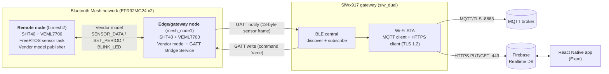

# Sensor-Mesh

**A Bluetooth Mesh environmental-sensor network on Silicon Labs EFR32MG24 nodes, bridged to the cloud by a SiWx917 Wi-Fi/BLE gateway, with a React Native app that shows live readings and sends commands back down to the hardware.**

Every layer is custom code: the I²C sensor drivers, the FreeRTOS tasks, a vendor-specific Bluetooth Mesh model, a custom GATT service, the BLE-central and Wi-Fi gateway firmware, the MQTT/HTTPS cloud uplink, and the phone app.

[](https://www.youtube.com/watch?v=PuSSsGJGB6g)

▶ **[Watch the demo and walkthrough on YouTube](https://www.youtube.com/watch?v=PuSSsGJGB6g)**: the hardware running end to end, with an explanation of how it works.

---

## Contents

1. [What it does](#what-it-does)
2. [System architecture](#system-architecture)
3. [Hardware](#hardware)
4. [Repository layout](#repository-layout)
5. [Firmware deep dive](#firmware-deep-dive)
   - [MG24 mesh nodes](#1-mg24-mesh-nodes-mesh_node1-btmesh2)
   - [Sensor drivers](#2-sensor-drivers-sensorsc)
   - [Vendor mesh model](#3-vendor-mesh-model-vendorc)
   - [GATT bridge service](#4-gatt-bridge-service-bridgec)
   - [SiWx917 gateway](#5-siwx917-gateway-siw_dual)
6. [Protocols and data formats](#protocols-and-data-formats)
7. [Mobile app](#mobile-app-react-app)
8. [End-to-end data flow](#end-to-end-data-flow)
9. [Building and flashing](#building-and-flashing)
10. [Engineering notes](#engineering-notes)
11. [Roadmap](#roadmap)

---

## What it does

- **Sense:** Each MG24 node reads temperature and relative humidity from an **SHT40** and ambient light from a **VEML7700** over I²C (Qwiic), in a dedicated FreeRTOS task.
- **Mesh:** The nodes form a provisioned **Bluetooth Mesh** network. The remote node publishes readings over a **custom vendor model** (company `0x02FF`, model `0x1234`).
- **Bridge:** One MG24 node is also the **edge gateway**. Alongside its mesh role, it runs a **custom 128-bit GATT service** that streams both its own readings and the readings relayed over the mesh to a BLE central.
- **Uplink:** A **SiWx917** (dual-mode Wi-Fi 6 + BLE SoC) connects to that GATT service as a BLE central, decodes the packets, and publishes the telemetry over **TLS** to:
  - an **MQTT broker** (`ucf/security/nodes/<id>/telemetry`, port 8883), and
  - **Firebase Realtime Database** (HTTPS `PUT /nodes/<id>.json`).
- **Control:** A **React Native (Expo)** app subscribes to Firebase for live dashboards and writes commands (blink, arm/disarm, set sample interval) back down. The command path is **App → Firebase → SiWx917 → BLE write → MG24 gateway → Mesh vendor message → remote node**.

---

## System architecture



The system has three tiers:

| Tier | Hardware | Role | Radio / transport |
|---|---|---|---|
| **Sensing** | EFR32MG24 (xG24 Explorer Kit, BRD2703A) | Sample sensors, publish over the mesh | Bluetooth Mesh (vendor model) |
| **Edge** | EFR32MG24 (`mesh_node1`) | Mesh node and GATT peripheral bridge | Bluetooth Mesh + BLE GATT |
| **Gateway** | SiWG917 (Dev Kit, BRD2605A) | BLE central, Wi-Fi uplink, command relay | BLE + Wi-Fi + TLS (MQTT, HTTPS) |
| **Cloud / UI** | Firebase RTDB, MQTT broker, phone | Store, fan out, visualize, control | HTTPS / WebSocket |

---

## Hardware

| Qty | Part | Notes |
|---|---|---|
| 2 | **Silicon Labs xG24 Explorer Kit (BRD2703A)**, EFR32MG24B210F1536IM48 | Cortex-M33 @ 78 MHz, 1.5 MB flash, 256 KB RAM, 2.4 GHz radio |
| 1 | **Silicon Labs SiWG917 Dev Kit (BRD2605A)**, SiWG917M111MGTBA | Cortex-M4 application core with Wi-Fi 6 and BLE 5.4 network processor |
| 2 | **Sensirion SHT40** | Temperature and RH, I²C `0x44`, high-precision mode (`0xFD`) |
| 2 | **Vishay VEML7700** | Ambient light, I²C `0x10`, gain ×1, 100 ms integration |
| – | Qwiic / STEMMA QT cables | Sensors sit on the Explorer Kit's Qwiic I²C bus (`sl_i2cspm_qwiic`) |
| – | Phone or PC | Provisioning (Simplicity Connect), running the Expo app |

**Toolchain:** Simplicity Studio 5, Simplicity SDK **2025.6.3**, WiSeConnect 3 SDK **3.5.2**, GNU ARM **12.2.1**, FreeRTOS (MG24 nodes and SiWx917).

---

## Repository layout

```
Sensor-Mesh/
├── mesh_node1/      MG24 edge node: mesh + sensors + GATT bridge to the SiWx917
│   ├── app.c            Mesh / BLE stack event handling, provisioning lifecycle
│   ├── app_freertos.c   FreeRTOS app task; starts sensor task and bridge timer
│   ├── sensors.c        SHT40 + VEML7700 drivers, mutex-protected sample cache
│   ├── vendor.c         Custom Bluetooth Mesh vendor model (4 opcodes)
│   ├── bridge.c         Custom GATT service: sensor notify + command write
│   └── config/btconf/   GATT database (Bridge Service UUIDs)
│
├── btmesh2/         MG24 remote node: mesh + sensors, reached over the mesh
│   ├── app.c            Provisioning, Generic OnOff client (button), vendor init
│   ├── sensors.c        Same sensor driver as mesh_node1
│   └── vendor.c         Same vendor model; handles SET_PERIOD / BLINK_LED
│
├── siw_dual/        SiWx917 gateway (final): BLE central + Wi-Fi + cloud
│   ├── ble_main_task.c  BLE scan / connect / multi-connection state machine
│   ├── ble_subtasks.c   Service and characteristic discovery, notification decode
│   ├── bridge_mqtt.c    MQTT/TLS publish, Firebase HTTPS PUT/GET, command relay
│   ├── bridge_mqtt.h    Shared node table (g_nodes[]) between BLE and network tasks
│   ├── wifi_http_s.c    Wi-Fi station bring-up, then hands off to the telemetry loop
│   └── firebase.pem.h   CA chain for the Firebase TLS connection
│
├── SiW917/          SiWx917 MQTT-only prototype (earlier stage, BLE stubbed)
├── bootloader/      Gecko bootloader for the MG24 nodes (required for .gbl images)
└── react-app/       React Native / Expo dashboard and control app
```

> Silicon Labs' generated build outputs (`GNU ARM v12.2.1 - Default/`) are committed on purpose. The `.axf`, `.map`, `.s37`, `.gbl`, and `.bin` files show that each project compiles and links. For example, `mesh_node1.gbl` is about 358 KB and `siw_dual.bin` is about 135 KB.

---

## Firmware deep dive

### 1. MG24 mesh nodes (`mesh_node1/`, `btmesh2/`)

Both nodes are built on the Silicon Labs Bluetooth Mesh stack, with FreeRTOS as the kernel.

**Lifecycle:**
1. **Boot.** If unprovisioned, the node sends unprovisioned-device beacons, and the LEDs blink on an `app_timer` while provisioning runs.
2. **Provisioning** (from Simplicity Connect). The node gets a unicast address and network/app keys. The device name is derived from the UUID (`"Therm %02x%02x"`).
3. **`node_initialized`.** The node registers the vendor model (`vendor_model_init()`). The edge node also starts its periodic publish loop (`vendor_start_publishing()`) and starts **connectable BLE advertising** of the Bridge Service on its own advertising set, separate from the mesh proxy's set.
4. **Run.** Mesh events go first to `vendor_model_on_event()`. Plain BLE events go first to `bridge_on_bt_event()`, so both the mesh and the GATT bridge run on the same radio at the same time.

**Factory reset:** hold PB0 at boot for a full reset, or PB1 for a node reset.

`btmesh2` also implements a **Generic OnOff client** (SIG model `0x1001`): a button press publishes a toggle with an incrementing transaction ID. `mesh_node1` implements the matching **Generic OnOff server** (`0x1000`) and drives its LED from it. This shows standard SIG models and the custom vendor model working side by side.

### 2. Sensor drivers (`sensors.c`)

These are bare drivers written against Silicon Labs' `I2CSPM` / emlib transfer API, not vendor libraries.

- **SHT40:** sends the high-precision measure command `0xFD`, waits 10 ms (the datasheet maximum is 8.3 ms), and reads 6 bytes. It converts with **integer math only**, to avoid pulling in soft-float:
  `T[m°C] = -45000 + 175000·raw/65535`, `RH[m%] = -6000 + 125000·raw/65535`, with RH clamped to 0–100 %.
- **VEML7700:** writes the configuration register (gain ×1, IT = 100 ms) and reads the ALS register LSB-first. It converts to **centilux** with `raw · 576 / 100` (0.0576 lux/count).
- **Concurrency:** a dedicated FreeRTOS task (`sensors`, priority 20, 512-word stack) samples every 1.5 s. It writes into a **mutex-protected cache**. Consumers (the mesh publish timer and the GATT notify timer) read through `sensors_get_latest()` with a 5 ms lock timeout, so a slow I²C bus never blocks the radio stack.

### 3. Vendor mesh model (`vendor.c`)

This is a custom Bluetooth Mesh vendor model shared by both nodes.

| Field | Value |
|---|---|
| Company ID | `0x02FF` |
| Model ID | `0x1234` |
| Element | 0 |

| Opcode | Name | Direction | Payload |
|---|---|---|---|
| `1` | `COUNTER_STATUS` | publisher → subscribers | `uint32` heartbeat counter (LE) |
| `2` | `SET_PERIOD` | controller → node | `uint32` period in ms (LE), clamped to 100 ms – 1 h |
| `3` | `BLINK_LED` | controller → node | *(empty)*: toggle LED0 |
| `4` | `SENSOR_DATA` | publisher → subscribers | 12 B: `int32 temp_mC`, `int32 rh_mPct`, `int32 lux_x100` (LE) |

**Design detail:** `bridge_publish_sample()` is declared **`__attribute__((weak))`** in `vendor.c`. On a node without `bridge.c`, received `SENSOR_DATA` goes to a no-op stub. On the edge node, the real implementation in `bridge.c` overrides it at link time and forwards the data to the gateway. The same `vendor.c` builds into both firmware images with no `#ifdef`s.

### 4. GATT bridge service (`bridge.c`)

The edge node exposes a custom primary service, defined in `config/btconf/gatt_configuration.btconf`:

| Item | UUID | Properties |
|---|---|---|
| **Bridge Service** | `d5bf276c-8b8e-49ed-93b0-9c569411ff89` | primary, advertised |
| Sensor data | `472ed3e4-e82f-40d4-921f-cda9af659e30` | read, **notify** |
| Command | `3d6539f9-5b0d-43d8-a902-b0641c236bc2` | write, write-without-response |

- **Peer identification:** the phone also connects, as a mesh proxy, so the bridge can't assume every connection is the gateway. It **claims the connection that enables CCCD notifications on the sensor characteristic** as the SiWx917, and releases it when that connection closes.
- **Telemetry:** a periodic `app_timer` (1 s by default, adjustable at runtime) notifies the local reading as source `0x01`. Readings received over the mesh are notified straight away as source `0x02`.
- **Commands:** writes to the Command characteristic are decoded and either run locally or turned into mesh vendor messages to the remote node (unicast `0x0002`). See [Command frame](#command-frame-gateway--edge-node).

### 5. SiWx917 gateway (`siw_dual/`)

This firmware runs the SiWx917 in **Wi-Fi + BLE coexistence mode** under CMSIS-RTOS2 (FreeRTOS), with separate threads for BLE and the network.

**BLE side** (`ble_main_task.c`, `ble_subtasks.c`, about 4,200 lines):
- Scans and connects to the edge node **by name**, then does full **service discovery** by 128-bit UUID (the UUID byte arrays are stored little-endian, as the stack reports them).
- Finds the sensor-data characteristic and its sibling command characteristic, enables notifications, and records the peer address and command handle in the shared `g_nodes[]` table.
- Decodes each 13-byte notification and maps source `0x02` to `node-0` and `0x01` to `node-1`. It converts fixed-point values to engineering units and increments a per-node sequence number.
- Clears `ble_ready` and the command handle on disconnect, so the network task never writes to a stale handle.

**Network side** (`wifi_http_s.c`, `bridge_mqtt.c`):
- Joins the access point as a WPA2 station with DHCP, then calls `bridge_telemetry_start()`.
- Loads **two CA certificates** into the network processor's credential slots: index 1 for the MQTT broker and index 2 for Firebase.
- Opens an **MQTT 3.1.1 session over TLS 1.2** (port 8883, keep-alive 60 s) with a **Last Will** (`ucf/security/last-will` → `"siw917 disconnected"`), so subscribers can detect when the gateway drops.
- Every 5 s, for each node, it:
  1. publishes JSON telemetry to `ucf/security/nodes/<id>/telemetry`,
  2. sends an **HTTPS `PUT /nodes/<id>.json`** to Firebase over a raw BSD socket with TLS offloaded to the NWP (`TCP_ULP "tls"`),
  3. sends an **HTTPS `GET /commands/<id>.json`** to poll for a pending command,
  4. if there is a command, converts it to a binary GATT write to the edge node, then **clears** it (`PUT null`) so it runs only once.

**`SiW917/`** is the earlier prototype of the gateway. It brings up Wi-Fi, TLS, and MQTT with a stubbed BLE layer (`app_bridge.c`). It is kept to show how the design developed.

---

## Protocols and data formats

### Sensor frame (edge node → gateway, GATT notify)

```
 byte:  0        1..4             5..8             9..12
       ┌────────┬────────────────┬────────────────┬────────────────┐
       │ source │ int32 temp_mC  │ int32 rh_mPct  │ int32 lux_x100 │   (little-endian)
       └────────┴────────────────┴────────────────┴────────────────┘
 source: 0x01 = edge node's own sensors, 0x02 = remote node (via mesh)
```

All values are **fixed-point integers** (milli-°C, milli-%, centi-lux). Floating-point conversion happens only on the SiWx917, which has an FPU and is where the data is formatted as JSON.

### Command frame (gateway → edge node, GATT write)

```
 byte:  0        1        2..
       ┌────────┬────────┬─────────────┐
       │ target │ opcode │ payload ... │
       └────────┴────────┴─────────────┘
 target bitmask: 0x01 = edge node (local), 0x02 = remote node (via mesh), 0x03 = both
 opcode 0x10 SET_LED     → local LED toggle / mesh BLINK_LED
 opcode 0x20 SET_PERIOD  → payload uint32 ms (LE); local timer / mesh SET_PERIOD
```

### Cloud JSON

MQTT `ucf/security/nodes/node-0/telemetry`:
```json
{"node":"node-0","seq":42,"temp_c":23.41,"humidity":48.12,"lux":312.5}
```

Firebase Realtime DB:
```
/nodes/<node-id>     { temp, humidity, lux }        ← written by the gateway
/commands/<node-id>  "blink" | "arm_on" | "arm_off" | {...}   ← written by the app, cleared by the gateway
```

---

## Mobile app (`react-app/`)

The app uses Expo (React Native 0.83, React 19) and the Firebase JS SDK.

- **Live dashboard:** an `onValue` subscription on `/nodes` renders a card per node with temperature, humidity, light, sequence number, and a freshness indicator (stale after 6 s), plus a LIVE/OFFLINE connection pill.
- **Controls:**
  - **Arm/Disarm:** sends `arm_on` / `arm_off` to every node.
  - **Blink `<node>`:** sends `blink` to one node, which flashes that board's LED. For `node-0` the command travels over the mesh.
  - **Set interval:** sends a new sampling or notify period to a node.
- MQTT-over-WebSocket topics (`ucf/security/#`) are already in the code, so the app can switch from Firebase to subscribing to the broker directly.

```bash
cd react-app
npm install
npx expo start      # scan the QR code with Expo Go, or press i / a / w
```

---

## End-to-end data flow

**Uplink (sensor → phone):**

```
SHT40/VEML7700 ──I²C──▶ sensor_task (FreeRTOS, 1.5 s)
                          │ mutex-protected cache
          ┌───────────────┴────────────────┐
   remote node (btmesh2)              edge node (mesh_node1)
   vendor SENSOR_DATA ──mesh──▶ vendor rx ─▶ bridge_publish_sample(0x02)
                                bridge timer ─▶ bridge_notify_sensor(0x01)
                                          │ GATT notify (13 B)
                                          ▼
                                SiWx917 BLE central ─▶ g_nodes[]
                                          │ every 5 s
                         ┌────────────────┴────────────────┐
                 MQTT/TLS publish                 HTTPS PUT /nodes/<id>
                                                          │
                                              Firebase RTDB ─▶ React app
```

**Downlink (phone → LED on a remote board):**

```
App button ─▶ Firebase /commands/node-0 = "blink"
          ─▶ SiWx917 polls GET /commands/node-0
          ─▶ GATT write [0x02, 0x10, ...] to the edge node
          ─▶ edge node: vendor_send_blink_led(0x0002) over the mesh
          ─▶ remote node: OPCODE_BLINK_LED → LED toggles
          ─▶ SiWx917 clears /commands/node-0
```

---

## Building and flashing

### Prerequisites
- Simplicity Studio 5 with **Simplicity SDK 2025.6.3** and the **WiSeConnect 3 (3.5.2)** extension
- Simplicity Commander, which is bundled with Studio
- Node.js 18+ for the app

### MG24 nodes
1. Import `bootloader/`, `mesh_node1/`, and `btmesh2/` into Simplicity Studio (*File → Import*, choose the `.slcp`).
2. Build and flash **`bootloader`** to both Explorer Kits. Do this once per board.
3. Build and flash **`mesh_node1`** to the edge board and **`btmesh2`** to the remote board.
4. Provision both nodes into the same network with the **Simplicity Connect** mobile app. Bind the app key to the vendor model (`0x02FF:0x1234`) and set publish/subscribe to a common group.
5. Open the VCOM (115200 baud) to watch the `app_log` output: sensor readings, `[mesh-rx]` traffic, and bridge status.

### SiWx917 gateway
1. Import `siw_dual/`.
2. Edit `wifi_app_config.h` (`SSID`, `PSK`), `bridge_mqtt.c` (broker address, client ID, Firebase host), and `ble_config.h` (the edge node's advertised name).
3. Build and flash. The console shows Wi-Fi join, certificate load, MQTT connect, BLE discovery, then a `Sensor[node-x]` line and a `[firebase node-x] HTTP/1.1 200 OK` line for each sample.

### App
Edit `react-app/firebase.js` to point at your Firebase project, then run `npx expo start`.

---

## Engineering notes

Problems solved along the way:

- **One radio, two roles.** The edge MG24 is a mesh node and a GATT peripheral at the same time. That needed a separate advertising set for the bridge service and event routing that lets mesh, proxy, and bridge handlers each see the events they need.
- **Telling BLE peers apart.** A mesh-proxy phone and the gateway can both connect. The bridge identifies the gateway by **which characteristic it subscribes to**, not by connection order.
- **No floats on the sensor path.** All sensor math is 64-bit-intermediate integer math in milli-units, which keeps soft-float out of the MG24 image and makes the wire format exact.
- **Thread safety.** The sensor cache is protected by a FreeRTOS mutex with a short timeout, so timer callbacks in the stack's context never block on I²C.
- **Link-time polymorphism.** A weak symbol lets one vendor-model source file build into two different firmware images.
- **TLS on a constrained device.** Two separate CA chains live in the SiWx917's credential store. TLS is offloaded to the network processor for both MQTT and raw-socket HTTPS.
- **Exactly-once commands.** The gateway clears each Firebase command after running it, so a slow poll doesn't run it twice.
- **UUID byte order.** The 128-bit UUIDs in the Studio GATT configurator are big-endian strings, but the SiWx917 BLE stack reports them little-endian. The gateway's UUID tables are stored in the order the stack actually reports.

---

## Roadmap

- [ ] Add the SHT40 CRC-8 check on every read
- [ ] Replace HTTPS polling for commands with an MQTT subscription, or Firebase streaming
- [ ] Use the SIG **Sensor Server/Client** models alongside the vendor model
- [ ] Add mesh **Low Power Node / Friend** support for battery-powered sensors
- [ ] Scale `g_nodes[]` and target addressing beyond two nodes
- [ ] Add Firebase Auth and database security rules

---

## Author

**Jacob**, embedded systems / IoT
Demo and walkthrough: <https://www.youtube.com/watch?v=PuSSsGJGB6g>

*Parts of the MG24 and SiWx917 projects started from Silicon Labs example applications (Bluetooth Mesh Sensor Server, Wi-Fi Coex HTTPS BLE Dual Role, Embedded MQTT Client), which are under the Zlib license. The sensor drivers, vendor model, GATT bridge, gateway bridging logic, cloud uplink, and mobile app were written for this project.*
